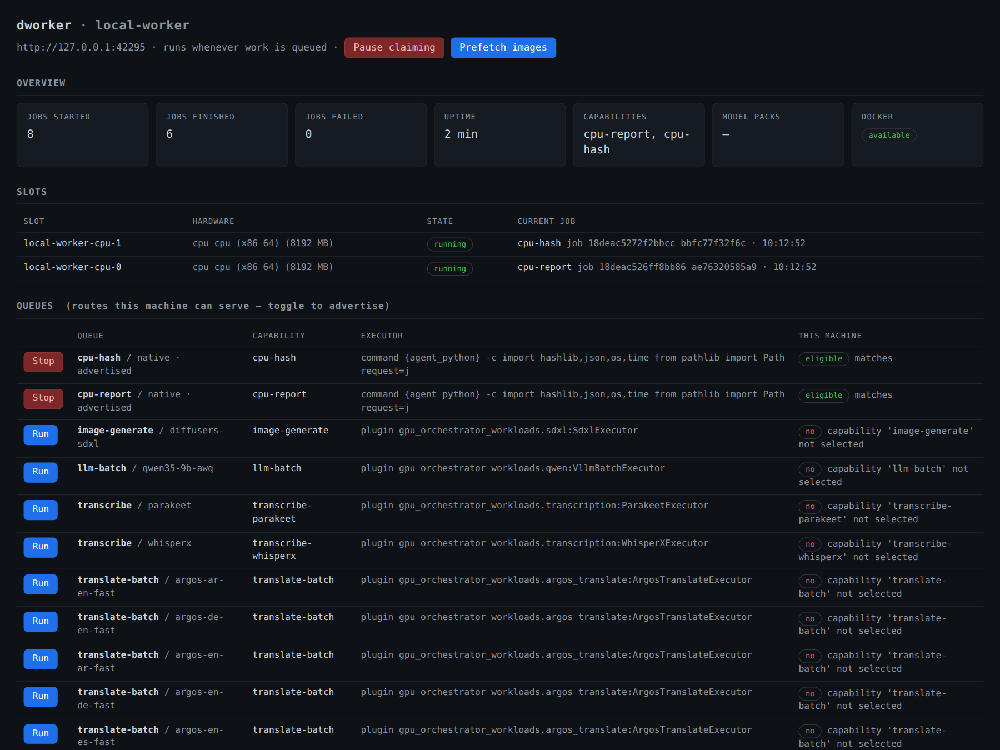

# dworker (distributed-worker)

`dworker` is the worker side of [Distributed
GPU](https://github.com/autonomica-xyz/distributed-gpu): an open-source CLI
and local dashboard that lets a workstation or server contribute spare
NVIDIA, AMD, or CPU compute to a control plane — SETI@home-style, claiming
independent jobs only when you tell it to. The controller (a separate,
GPL-3.0-or-later package) defines trusted workload routes, stores jobs
durably, and schedules at most one job per worker slot; `dworker`
registers slots, advertises the capabilities you select, and runs the jobs
it claims.



*A local example worker with two CPU slots, active jobs, and workload eligibility.*

## What it does

- **Inventory** — detects NVIDIA GPUs via `nvidia-smi`, AMD GPUs via the
  amdgpu sysfs tree, and configurable CPU slots (`cpu_slots=N`), and
  reports usable cores/RAM after affinity and cgroup limits.
- **Queue visibility** — `dworker doctor` and `dworker queues` show every
  route the controller offers and whether this machine matches (vendor,
  VRAM, compute capability, GPU model, model packs, labels), with the
  reason when it does not.
- **Explicit selection** — you choose what to advertise:
  `dworker select translate-batch`, or the Run/Stop toggles in the
  dashboard. Toggles re-register live; a running job always finishes.
- **Idle gating** — with `idle_only=true` the worker claims only while the
  machine is confirmed idle: all local sessions locked, or quiet past
  `idle_after_seconds`. Detection reads logind/X11 on Linux,
  `IOConsoleLocked`/`HIDIdleTime` on macOS, and `GetLastInputInfo` on
  Windows. Ambiguous or missing signals fail closed — no new claiming.
  Idle gating does not preempt jobs already running.
- **Dynamic mode** — with `dynamic=true` and an agent token carrying
  `perms=dynamic`, the worker watches per-route queue depth and advertises
  exactly the capabilities that have pending work, downloading and
  SHA-256-verifying demanded model packs before the first claim.
- **Prefetch** — `dworker prefetch` docker-pulls the digest-pinned images
  behind your selected capabilities and reports what model packs or local
  model servers a route still needs.
- **Dashboard** — during `dworker run`, a status page binds a **literal
  loopback address only** (default `http://127.0.0.1:7788`); every `/api/*`
  call needs a per-run bearer token delivered in the URL fragment and
  stored mode-0600 in `config.json.dashboard-url`.

## Requirements

- Python 3.10 or newer. GPU drivers and inference runtimes are
  platform-specific; Linux is recommended for GPU workers.
- The separate `distributed-gpu` package, installed from source or a wheel.
- For container routes, Docker and access to its daemon.
- For AMD execution, a ROCm-capable runtime, accessible `/dev/kfd` and
  `/dev/dri`, and a card with a nonzero sysfs `unique_id`.

Install each route's executor, runtime and reviewed model packs before
advertising it. ML dependencies and weights are not part of the base worker
install. The controller's [workload guide](https://github.com/autonomica-xyz/distributed-gpu/blob/main/workloads/README.md)
and [runtime profiles](https://github.com/autonomica-xyz/distributed-gpu/tree/main/deploy)
describe those prerequisites. Bundled ML routes target NVIDIA; AMD and CPU
capacity need compatible routes configured by your controller operator.

## Install

Both packages install from source. The worker depends on the control-plane
package, so install that first:

```bash
git clone https://github.com/autonomica-xyz/distributed-gpu.git
git clone https://github.com/autonomica-xyz/distributed-worker.git
python3 -m venv ~/.local/share/dworker/venv
~/.local/share/dworker/venv/bin/pip install ./distributed-gpu ./distributed-worker
export PATH="$HOME/.local/share/dworker/venv/bin:$PATH"
```

For always-on hosts, [`deploy/dworker.service`](deploy/dworker.service) is
an example per-user systemd unit matching this installation. Follow its
session-environment and lingering instructions for workstation idle detection.

## First run

From the controller checkout, issue an agent token using the same controller
database as the running service. Scope it to the intended workloads; repeat
`--scope` per value. Never give a worker an admin or client token.

```bash
umask 077
mkdir -p state
.venv/bin/dgpu token --role agent --subject tower-a \
    --scope routes=translate-batch --expires-hours 720 > state/tower-a.token
```

Transfer that file privately to the worker host as `token.txt`. Replace the
example endpoint below with your controller's HTTPS address.

Then on the worker host:

```bash
dworker login --endpoint https://gpu-control.example.com \
    --token-file token.txt --agent-id tower-a
dworker doctor                       # hardware, token, idle probe, queue matrix
dworker select translate-batch       # advertise a capability
dworker run                          # claim loop + dashboard on 127.0.0.1:7788
```

Open the full dashboard access URL printed in an interactive terminal, or
read it from `~/.config/dworker/config.json.dashboard-url`. Its private
per-run token is separate from the controller credential; do not share the
URL. The plain localhost URL alone does not authenticate a browser.

Useful variations:

```bash
dworker config set idle_only=true        # claim only while confirmed idle
dworker config set idle_after_seconds=600
dworker config set cpu_slots=4           # GPU-less box serving vendor=cpu routes
dworker run --cpu-slots 2                # one-run override, nothing saved
dworker run --once                       # smoke test: one job per slot, then exit
```

Dynamic (queue-driven) selection needs the depth signal on the token
(`--scope perms=dynamic`) plus `dworker config set dynamic=true` and a
`model_catalog` pointing at a lock catalog (local file or HTTPS URL) in the
controller's `models/*.lock.json` format; install the `[models]` extra for
Hugging Face pack downloads.

## Security and trust limits

- The endpoint must be HTTPS; only loopback endpoints are exempt. TLS
  verification is never disabled (use `SSL_CERT_FILE`/`SSL_CERT_DIR` for a
  private CA), and model downloads never receive the controller token.
- The controller and its workload registry are the code authority:
  executors are trusted commands, plugin handlers, or digest-pinned
  container images chosen by the registry — job submitters cannot pick
  executors or inject code/models. Run the worker under a user whose
  privileges you are comfortable granting the controller operator.
- The dashboard is not a remote management surface: literal loopback bind,
  per-run token, strict origin checks. Do not proxy or expose it.
- Provider credentials (Vast, Salad, …) live on the controller and are
  never sent to workers.
- One job per slot: a host with N registered slots runs at most N
  independent jobs concurrently — this is not multi-GPU training or model
  sharding.
- Fixed local model services (LibreTranslate, vLLM) are operator-started
  loopback services; the worker checks readiness but does not daemonize
  them, and one fixed endpoint must not be advertised as backed by
  several GPU slots.

## Commands

| command | purpose |
|---------|---------|
| `login` | store endpoint + agent token (config is mode 0600; `config` redacts it) |
| `doctor` | connectivity, hardware, token, idle probe, queue match table |
| `queues` | just the queue matrix |
| `select` / `deselect` | toggle advertised capabilities (live) |
| `prefetch` | docker-pull images for selected capabilities |
| `run` | the worker loop (`--once`, `--idle-only`, `--idle-after`, `--cpu-slots`, `--no-dashboard`) |
| `config` | get/set settings (`config set cpu_slots=4`); file: `~/.config/dworker/config.json` |

Key config keys: `capabilities` (empty claims nothing), `cpu_slots`,
`idle_only`, `idle_after_seconds`, `dynamic`, `model_catalog`, `workdir`,
`labels` (string→string placement labels), `dashboard_host`,
`dashboard_port`, `poll_seconds`, `heartbeat_seconds`, and `lease_seconds`.

## Known ceilings

- Capabilities are per-host, not per-GPU: a host advertises the same set
  on every slot.
- Idle detection fails closed: an unclassifiable session or a platform
  with no signal means "not idle" — `idle_only` then simply claims
  nothing.
- Dynamic selection never rewrites your saved capabilities. Downloaded
  model packs remain on disk until you prune them; container images are
  cached by Docker after the first pull.

## License

MIT — see [LICENSE](LICENSE). This worker depends on the `distributed-gpu`
control-plane package, which is **GPL-3.0-or-later** and distributed
separately; installing this worker alongside it does not change its
license.
